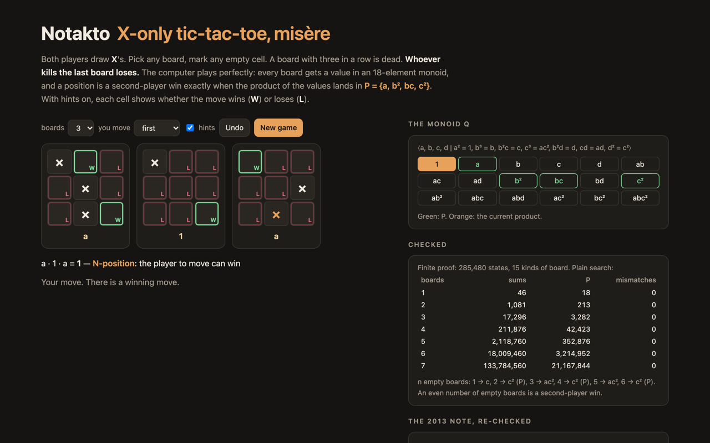

# Notakto — X-only misère tic-tac-toe against a perfect player, and the 2013 misère quotient re-derived



**Notakto** in the browser, against a perfect player. Both players draw X's. On your turn pick any of the boards
and mark any empty cell; a board with three in a row is dead. Whoever kills the last board loses. One to six boards.

The game was suggested by Bob Koca and discussed on MathOverflow in 2010; Thane Plambeck and Greg Whitehead solved
every number of boards in a 2013 note, *The Secrets of Notakto*. Their tool is a **misère quotient**: an 18-element
commutative monoid

Q = ⟨a, b, c, d | a² = 1, b³ = b, b²c = c, c³ = ac², b²d = d, cd = ad, d² = c²⟩,

a value in Q for each of the 102 boards up to symmetry, and the set P = {a, b², bc, c²}. Multiply the values of the
boards in play; the position is a second-player win iff the product is in P. The page does exactly that, and with
hints on marks each empty cell **W** (it moves to a P-position) or **L**.

The note takes Q as given and prints the dictionary as a figure. Here both are re-derived and checked: the monoid
from its presentation, the dictionary against a finite proof that covers sums of **any** number of boards, and the
proof against plain game search.

TypeScript, no runtime dependencies.

## The monoid

[`src/monoid.ts`](src/monoid.ts). Words in a, b, c, d are exponent vectors; the relations become rewrite rules
(ordered by degree, then d > c > b > a) and Knuth–Bendix completion adds the resolvent of every critical pair that
does not join. For this presentation nothing is added: the seven relations are already a complete rewriting system,
and their 18 irreducible words are exactly the note's list.

## The proof that the dictionary decides every sum

[`src/quotient.ts`](src/quotient.ts), `proveSums`. Fix a value Φ(G) for every board G (dead boards are 1). Whether a
sum is P follows from its options: it is P iff it has a live board and no move reaches a P sum. A move on a board G
replaces Φ(G)·r by Φ(G′)·r, where r is the product of the other boards. So, assuming the rule holds for every smaller
sum, the outcome of a sum depends only on

- x, the product of all the boards, and
- for each **kind** of board present, the product r of the rest. A kind is the pair (Φ(G), {Φ(G′)}); boards of the
  same kind are interchangeable for this purpose.

Start with no boards and add one board of each kind in turn; the states (x, r per kind) are finitely many. Check
"P iff no option is P" against "P iff x ∈ P" at every state, and by induction on the number of empty cells the rule
holds for every sum of every size. For the 2013 dictionary there are 15 kinds and **285,480** states; the walk
takes about 5 s and finds no counterexample.

Two more facts make Q the misère quotient rather than just *a* monoid that works: products of board values reach
all 18 elements, and no two elements behave the same in every context (Q is reduced).

## What came out

`npm run stats` writes [`runs/stats.json`](runs/stats.json); `npm run brute` writes
[`runs/brute.json`](runs/brute.json); `npm run literature` compares them with the note and writes
[`src/results.json`](src/results.json). Node 26, Mac mini, one thread.

### Plain search agrees

[`tools/brute.mts`](tools/brute.mts) knows nothing about monoids: it searches the game tree of every multiset of the
46 live boards, with a one-byte memo per multiset (ranked in the combinatorial number system — a `Map` stops at
about 16.7 million keys).

| boards | sums | P-positions | mismatches | time |
|---:|---:|---:|---:|---:|
| 1 | 46 | 18 | 0 | 1 ms |
| 2 | 1,081 | 213 | 0 | 3 ms |
| 3 | 17,296 | 3,282 | 0 | 46 ms |
| 4 | 211,876 | 42,423 | 0 | 432 ms |
| 5 | 2,118,760 | 352,876 | 0 | 6.2 s |
| 6 | 18,009,460 | 3,214,952 | 0 | 64.8 s |
| 7 | 133,784,560 | 21,167,844 | 0 | 722.1 s |
| total | 154,143,079 | | 0 | |

### The claims

| claim | result |
|---|---|
| 102 non-isomorphic ways of arranging zero to nine X's | ✓ yes: 102 classes, Burnside gives 102; 46 of them have no line |
| Q = ⟨a,b,c,d \| a²=1, b³=b, b²c=c, c³=ac², b²d=d, cd=ad, d²=c²⟩ has eighteen elements, the ones listed | ✓ yes: the seven relations are already a complete rewriting system (21 critical pairs, none new); 18 normal forms |
| multiply the dictionary values; the sum is a P-position iff the product is in P = {a, b², bc, c²} | ✓ yes, for sums of any size: a finite check over 285,480 states (15 kinds of board) proves it; plain search agrees on all 154,143,079 sums of up to 7 boards (0 mismatches) |
| Q is the misère quotient | ✓ yes: the products reach all 18 elements and no two elements behave alike in every context (0 pairs) |
| positions with too many completed rows are all assigned the identity | ✓ yes: all 56 dead boards are 1 (and 3 live ones too) |
| the dictionary (Figure 7) | ✓ forced: each of the 782 one-entry changes breaks the proof. (Q, P) has 4 automorphisms; 3 of them rename d and relabel the 4 d/ad entries, and those dictionaries work too |
| one board: the first player wins by playing in the centre | ✓ yes; the empty board is c |
| …then wherever the second player plays, a knight's move away from that | ✓ yes, as long as the knight's move does not complete a line (32 times one of the two would); whenever two such moves exist (8 times) both win |
| any move other than the centre loses: reply diametrically opposite, then rotate by 180° | ✓ yes: centre is the only winning first move, and the rotation reply wins against all 8 other openings and every continuation |
| two empty boards: c², a second-player win | ✓ yes |
| after a centre opening, copying it on the other board wins (c⁴ = c²) | ✓ yes; after a corner or edge opening the copy loses (1·1 = 1). Of the 46 live boards, 26 are P when doubled |
| Figure 5 is an N-position and the copy (top-right of the right board) loses | ✓ yes: ab, the copy makes 1. The winning replies: middle-left of the left board, middle-right of the left board, bottom-middle of the left board, bottom-right of the right board (the last one completes the diagonal) |
| the empty board is {2+, 0} and nim-heap 4 occurs as a single board (footnote) | — not checked (misère canonical forms are not implemented); the three boards with Grundy value 4 are exactly the ones valued d |

### The dictionary is forced (almost)

Change any one of the 46 live entries to any of the other 17 elements: all **782** such dictionaries fail the proof.
But (Q, P) has **4 automorphisms**. They fix a, b, c and send d to d, ad, bd or abd; applied to the dictionary they
change only the four entries valued d or ad (two X's side by side on an edge, valued ad, and the three boards that
add a third X off that line, valued d), and
those dictionaries pass the proof too. Which of the two families is called *d* is a choice of name, not something
the game decides.

### Why not Grundy values

In normal play (last move wins) every board would be a nim-heap. The three boards valued d are exactly the ones with
Grundy value 4 — the footnote's "nim-heap of size 4" — but misère play cannot be read off Grundy values. The usual
misère-nim rule (P iff xor = 0 with some heap ≥ 2, or xor = 1 with all heaps ≤ 1) already fails on one empty board
(Grundy value 1, so "P"; really a first-player win):

| boards | sums | misère-nim guess wrong |
|---:|---:|---:|
| 1 | 46 | 2 (4.3%) |
| 2 | 1,081 | 41 (3.8%) |
| 3 | 17,296 | 638 (3.7%) |
| 4 | 211,876 | 8,789 (4.1%) |

### Small things the note says in words

- One board: the centre is the only winning first move. After it, "a knight's move away" from each reply wins —
  read as "a knight's move that does not complete a line" (32 times, counting orientations, one of the two
  knight's moves would); 8 times there are two such moves and both win. Any
  other opening loses to the diametrically opposite reply and then the 180° rotation, against all 8 openings and
  every continuation.
- n empty boards: c, c², ac², c², ac², c²: odd is a first-player win, even a second-player win.
- Copying the opponent on two boards works after a centre opening (c⁴ = c²), but after a corner or edge opening
  the copy loses (1 · 1 = 1). Of the 46 live boards, 26 are P when doubled.
- Figure 5 (left: corners and centre; right: one corner and centre) is ab. The copy (top-right of the right board)
  makes 1 and loses. The winning replies are middle-left, middle-right or bottom-middle of the left board — or
  completing the diagonal on the right board, killing it.

Not checked: the footnote's misère canonical forms ({2+, 0} for the empty board). That needs a misère simplification
algorithm, which this repo does not implement.

## Run it

```sh
npm install
npm run dev        # the game
npm test           # 19 tests, about 30 s (the proof and the 782 mutations dominate)
npm run stats      # monoid, proof, automorphisms, claims (~10 s)
npm run brute      # plain search on all sums of up to 6 boards (~75 s)
node tools/brute.mts 7  # up to 7 boards, as in runs/brute.json (~12 minutes, ~200 MB)
npm run literature # rebuild src/results.json from runs/
```

## Sources

- T. E. Plambeck, G. Whitehead, [The Secrets of Notakto: Winning at X-only Tic-Tac-Toe](https://arxiv.org/abs/1301.1672)
  (2013).
- T. Y. Chow, [Neutral tic tac toe](https://mathoverflow.net/questions/24693/neutral-tic-tac-toe), MathOverflow
  (2010).
- T. E. Plambeck, A. N. Siegel, [Misère quotients for impartial games](https://arxiv.org/abs/math/0609825) (2008).

## License

MIT. See [LICENSE](LICENSE).
